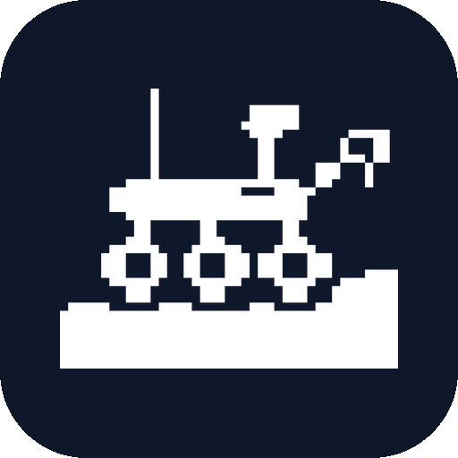
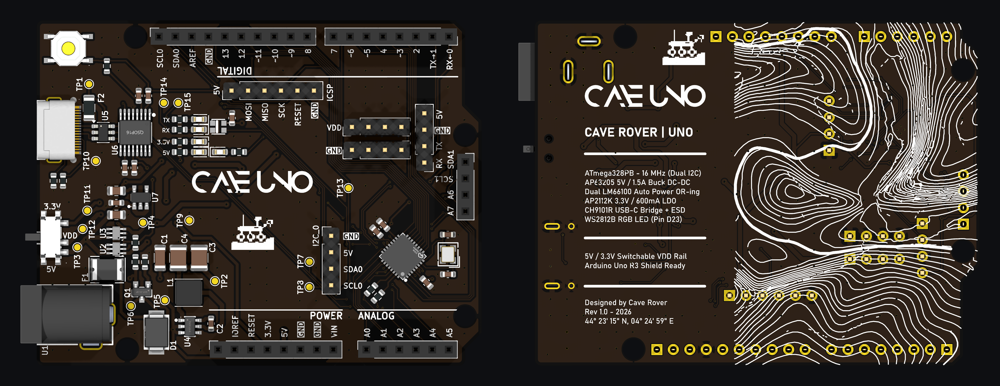
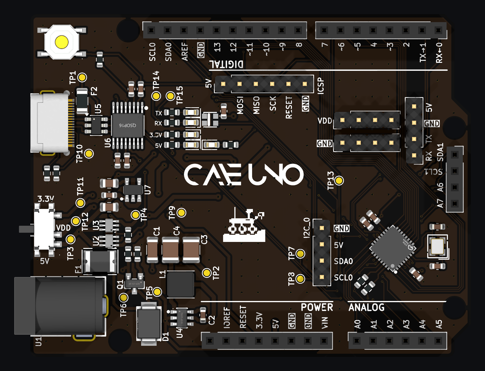
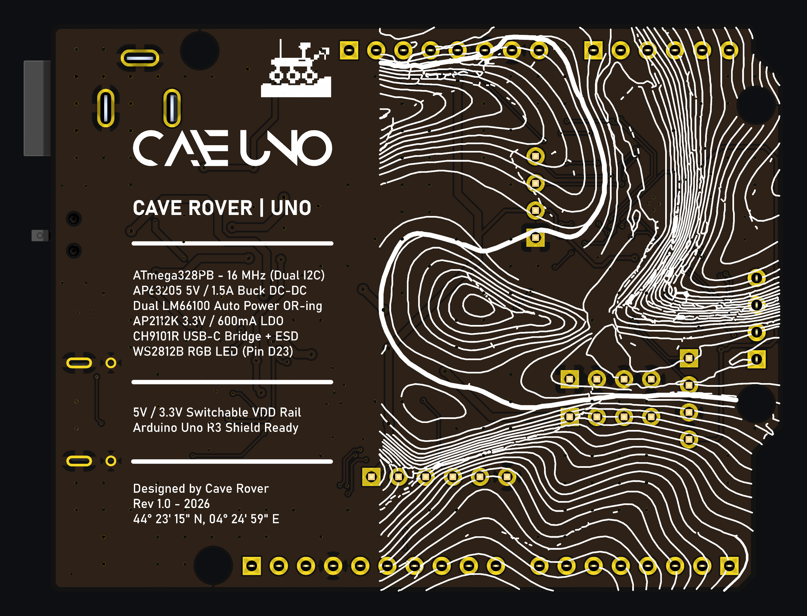
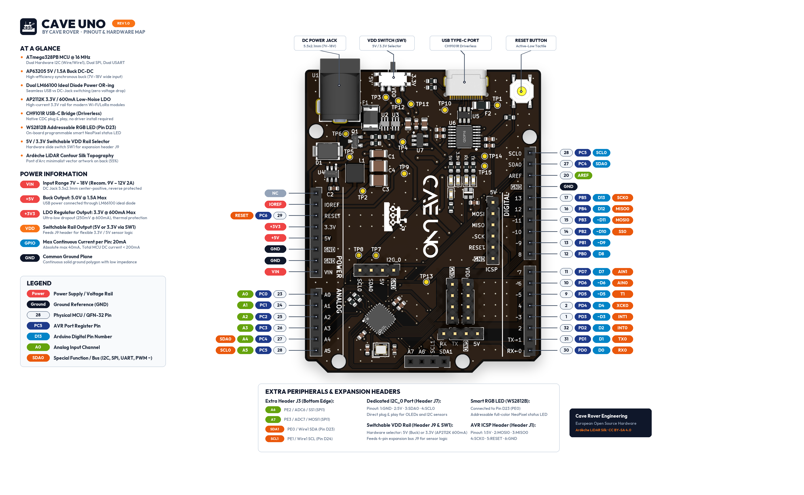
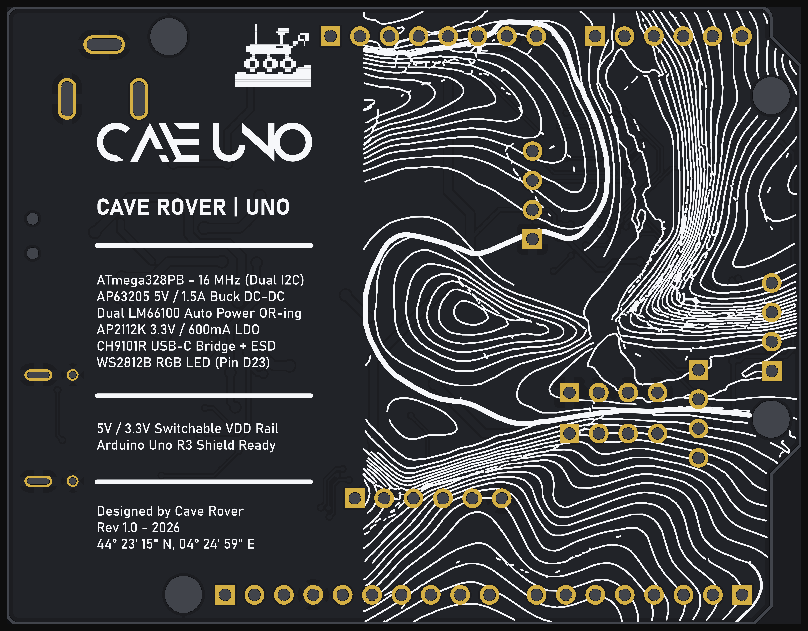

<p align="center">
  
</p>

<h1 align="center">Cave Uno (Rev 1.0)</h1>

<p align="center">
  <b>English</b> | <a href="README_FR.md">Version Française 🇫🇷</a>
</p>

<p align="center">
  <a href="https://ohwr.org/cern_ohl_p_v2.txt"></a>
  <a href="https://creativecommons.org/licenses/by-sa/4.0/"></a>
  <a href="https://www.kicad.org/"></a>
  <a href="https://www.microchip.com/en-us/product/ATmega328PB"></a>
  <a href="#tailored-for-technical--engineering-education"></a>
  <a href="#european-engineering--heritage"></a>
  <a href="#highlights--key-features"></a>
</p>

**Cave Uno** is a next-generation open-source microcontroller development board engineered in Europe by **Cave Rover**. Conceived specifically for **engineering, electronics, and technical students**, as well as makers and university labs, Cave Uno is an upgraded, modern reinterpretation of the iconic **Arduino Uno Rev3**. 

It retains 100% mechanical, electrical, and shield compatibility with the Uno R3 form factor while addressing all classic limitations through modern silicon: **reversible USB-C with native plug-and-play driverless operation**, a high-efficiency synchronous buck converter, zero-voltage-drop ideal diode power OR-ing, a high-current 3.3V rail, switchable logic voltage, the extended peripherals of the **Microchip ATmega328PB**, and high-precision LiDAR vector silkscreen art celebrating the Ardèche river canyon.

---

## 🖼️ 3D Assembled Board Overview (KiCad Raytracing)



<p align="center">
  
  
</p>

---

## 🎓 Tailored for Technical & Engineering Education

Traditional 8-bit educational boards often suffer from fragile power regulators, obsolete USB connectors, driver configuration hurdles, and single-bus bottlenecks. Cave Uno addresses these issues directly for students and educators:

* **100% Shield & Form-Factor Compatibility:** Fits existing Arduino Uno R3 shields, breadboard adapters, and lab enclosures without mechanical clashes.
* **Driverless Out-of-the-Box Experience:** No driver installers, unsigned driver warnings, or OS compatibility issues. Connect the USB-C cable and start coding immediately in the Arduino IDE.
* **Laboratory-Grade Power Protection:** Overvoltage-protected DC input, full TVS ESD suppression on USB data lines, and ideal diode reverse-current blocking prevent common lab wiring accidents.
* **Real-World Bus Architecture:** Teaches students modern multi-bus embedded design with Dual Hardware I2C (`Wire` / `Wire1`), Dual Hardware SPI, and Dual UART.
* **Flexible Logic Interfacing:** Eliminates messy resistor dividers and external level shifters when testing 3.3V sensors via the physical `SW1` VDD rail selector.

---

## ⚡ Highlights & Key Features

* **European Design & Heritage:** Designed and routed in Europe (France / Ardèche), featuring LiDAR elevation contours of the Pont d'Arc canyon and UNESCO Chauvet Cave.
* **Advanced ATmega328PB AVR Core @ 16 MHz:**
  * **Dual Hardware I2C (TWI0 & TWI1):** Independent simultaneous buses.
  * **Dual Hardware SPI (SPI0 & SPI1):** High-speed parallel display and SD logging.
  * **Dual USART (USART0 & USART1):** Dedicated serial monitor + hardware sensor telemetry.
  * **9 PWM Channels:** 3 extra output compare channels over standard 328P.
* **Modern Driverless USB-C Connectivity:** Powered by the **WCH CH9101R** USB-to-UART bridge with native OS CDC compliance across Windows 10/11, macOS, and Linux. No third-party drivers needed.
* **High-Efficiency 1.5A Synchronous Buck Converter:** Built with the **AP63205** step-down DC-DC regulator, accepting **7V to 18V** input with >90% efficiency.
* **Zero-Drop Power OR-ing:** Dual **LM66100** ideal diode controllers manage seamless switching between USB and external power with virtually zero voltage drop.
* **High-Current 600mA 3.3V Rail:** Dedicated **AP2112K-3.3** low-noise LDO powers modern power-hungry Wi-Fi (ESP8266/ESP32), radio (NRF24, LoRa), and sensor modules.
* **Selectable VDD Header (`SW1`):** A SPDT slide switch routes either **+5V** or **+3.3V** to the `J9` expansion bus.
* **Smart RGB NeoPixel LED:** Integrated addressable **WS2812B (2020)** RGB LED connected to GPIO `D23` (`PE0`) for user status and interactive tutorials.
* **Dedicated I2C_0 Port (`J7`):** Direct 4-pin connection (GND, 5V, SDA, SCL) for immediate sensor prototyping.
* **Dedicated UART Port (`J8`):** Direct 4-pin connection (RX0, TX0, GND, 5V) for serial modules and loggers.

---

## 📐 Pinout & Architecture



### Comprehensive Pin-by-Pin Mapping Table

Every single pin across all headers on the board is detailed below:

| Header | Pin # | Silk Label | MCU Port | TQFP-32 Pin | Default Function | Alternate & Special Functions |
|:---|:---:|:---|:---:|:---:|:---|:---|
| **J4** (Top Digital) | 10 | **SCL0** | PC5 | Pin 28 | Wire / TWI0 SCL | Analog Input A5, PCINT13 |
| | 9 | **SDA0** | PC4 | Pin 27 | Wire / TWI0 SDA | Analog Input A4, PCINT12 |
| | 8 | **AREF** | — | Pin 20 | AREF | Analog Voltage Reference Input |
| | 7 | **GND** | — | — | Ground | Digital Ground Reference |
| | 6 | **13** | PB5 | Pin 17 | Digital I/O | SCK0 (SPI0 Clock), Built-in LED L |
| | 5 | **12** | PB4 | Pin 16 | Digital I/O | MISO0 (SPI0 Master In / Slave Out) |
| | 4 | **~11** | PB3 | Pin 15 | Digital I/O | MOSI0 (SPI0 Master Out), PWM (Timer2 OCA) |
| | 3 | **~10** | PB2 | Pin 14 | Digital I/O | SS0 (SPI0 Slave Select), PWM (Timer1 OCB) |
| | 2 | **~9** | PB1 | Pin 13 | Digital I/O | PWM (Timer1 OCA) |
| | 1 | **8** | PB0 | Pin 12 | Digital I/O | CLKO / ICP1 (Timer1 Input Capture) |
| **J6** (Bottom Digital) | 8 | **7** | PD7 | Pin 11 | Digital I/O | AIN1 (Analog Comparator Negative In) |
| | 7 | **~6** | PD6 | Pin 10 | Digital I/O | AIN0 (Analog Comparator Positive In), PWM |
| | 6 | **~5** | PD5 | Pin 9 | Digital I/O | T1 (Timer1 Clock In), PWM (Timer0 OCB) |
| | 5 | **4** | PD4 | Pin 2 | Digital I/O | XCK0 (USART0 Clock), T0 |
| | 4 | **~3** | PD3 | Pin 1 | Digital I/O | INT1 (External Interrupt 1), PWM |
| | 3 | **2** | PD2 | Pin 32 | Digital I/O | INT0 (External Interrupt 0) |
| | 2 | **TX → 1** | PD1 | Pin 31 | UART TX0 | USART0 Asynchronous Transmit |
| | 1 | **RX ← 0** | PD0 | Pin 30 | UART RX0 | USART0 Asynchronous Receive |
| **J5** (Power) | 1 | **NC** | — | — | Not Connected | Uncommitted pin |
| | 2 | **IOREF** | — | — | +5.0V | Shield Logic Reference Voltage |
| | 3 | **RESET** | PC6 | Pin 29 | Active-Low Reset | Target MCU hardware reset |
| | 4 | **3.3V** | — | — | +3.3V Regulated | AP2112K LDO Output (600mA continuous) |
| | 5 | **5V** | — | — | +5.0V Regulated | AP63205 Buck / USB VBUS (1.5A max) |
| | 6 | **GND** | — | — | Ground | System Power Ground |
| | 7 | **GND** | — | — | Ground | System Power Ground |
| | 8 | **VIN** | — | — | Raw Input (7V–18V) | Power input from 5.5x2.1mm DC Barrel Jack |
| **J2** (Analog) | 1 | **A0** | PC0 | Pin 23 | Analog Input 0 | ADC Channel 0, PCINT8 |
| | 2 | **A1** | PC1 | Pin 24 | Analog Input 1 | ADC Channel 1, PCINT9 |
| | 3 | **A2** | PC2 | Pin 25 | Analog Input 2 | ADC Channel 2, PCINT10 |
| | 4 | **A3** | PC3 | Pin 26 | Analog Input 3 | ADC Channel 3, PCINT11 |
| | 5 | **A4** | PC4 | Pin 27 | Analog Input 4 | ADC Channel 4 / Wire TWI0 SDA |
| | 6 | **A5** | PC5 | Pin 28 | Analog Input 5 | ADC Channel 5 / Wire TWI0 SCL |
| **J3** (Extra I/O Header) | 1 | **SDA1** | PE0 | Pin 25 | Wire1 / TWI1 SDA | GPIO D23, WS2812B RGB DIN, RXD1 |
| | 2 | **SCL1** | PE1 | Pin 26 | Wire1 / TWI1 SCL | GPIO D24, MISO1 (SPI1), TXD1 |
| | 3 | **A6** | PE2 | Pin 19 | Analog Input 6 | ADC Channel 6, SS1 (SPI1 Slave Select) |
| | 4 | **A7** | PE3 | Pin 22 | Analog Input 7 | ADC Channel 7, MOSI1 (SPI1 Master Out) |
| **J7** (Dedicated I2C_0) | 1 | **GND** | — | — | Ground | Ground reference for I2C modules |
| | 2 | **5V** | — | — | +5.0V Regulated | 5V power supply rail for I2C sensors |
| | 3 | **SDA0** | PC4 | Pin 27 | Wire / TWI0 SDA | Primary I2C bus serial data |
| | 4 | **SCL0** | PC5 | Pin 28 | Wire / TWI0 SCL | Primary I2C bus serial clock |
| **J8** (Dedicated UART_0) | 1 | **D0** | PD0 | Pin 30 | UART RX0 | Hardware serial receive |
| | 2 | **D1** | PD1 | Pin 31 | UART TX0 | Hardware serial transmit |
| | 3 | **GND** | — | — | Ground | Serial ground reference |
| | 4 | **5V** | — | — | +5.0V Regulated | 5V power supply rail for serial modules |
| **J9** (Switchable VDD) | 1 | **VDD** | — | — | Rail Output 1 | Selected via SW1 (5V or 3.3V) |
| | 2 | **VDD** | — | — | Rail Output 2 | Selected via SW1 (5V or 3.3V) |
| | 3 | **VDD** | — | — | Rail Output 3 | Selected via SW1 (5V or 3.3V) |
| | 4 | **VDD** | — | — | Rail Output 4 | Selected via SW1 (5V or 3.3V) |
| **J10** (Extra GND Bus) | 1 | **GND** | — | — | Ground Pin 1 | System solid ground return |
| | 2 | **GND** | — | — | Ground Pin 2 | System solid ground return |
| | 3 | **GND** | — | — | Ground Pin 3 | System solid ground return |
| | 4 | **GND** | — | — | Ground Pin 4 | System solid ground return |
| **J1** (AVR ICSP Header) | 1 | **5V** | — | — | +5.0V Regulated | Target power during ISP programming |
| | 2 | **MOSI0** | PB3 | Pin 15 | SPI0 MOSI | In-System Programming Data In |
| | 3 | **MISO0** | PB4 | Pin 16 | SPI0 MISO | In-System Programming Data Out |
| | 4 | **SCK0** | PB5 | Pin 17 | SPI0 SCK | In-System Programming Clock |
| | 5 | **RESET** | PC6 | Pin 29 | Active-Low Reset | Target MCU hardware reset control |
| | 6 | **GND** | — | — | Ground | Programmer ground reference |

---

## 🔬 Hardware Diagnostic & Lab Test Points (`TP1` – `TP15`)

To facilitate oscilloscope probing, multimeter diagnostics, and hands-on electronics lab exercises, the Cave Uno integrates **15 surface-mount test pads** (Ø 1.0 mm ENIG gold pads on `F.Cu`):

| Test Point | Silkscreen / Value | Schematic Net | Nominal Signal / Voltage | Diagnostic & Laboratory Purpose |
|:---:|:---:|:---|:---:|:---|
| **TP1** | `USBVCC` | `USBVCC` | +5.0V DC | Raw USB-C $V_{BUS}$ input (upstream of ideal diode `U3`) |
| **TP2** | `VOUT` | `VOUT` | +5.0V DC | Regulated output of the `U4` (`AP63205`) synchronous buck converter (upstream of ideal diode `U2`) |
| **TP3** | `+5V` | `+5V` | +5.0V DC | Main system `+5V` rail (downstream of the dual `LM66100` ideal diode OR-ing stage) |
| **TP4** | `CE` | `Net-(U2-ST)` | Logic Signal | Cross-coupled Status / Chip-Enable (`ST`/`CE`) handshaking line between ideal diodes `U2` and `U3` |
| **TP5** | `VCC` | `VCC` | 7V – 18V DC | Reverse-polarity protected DC input (downstream of protection diode `D1`, feeding buck converter `U4`) |
| **TP6** | `VIN` | `Net-(D1-A)` | 7V – 18V DC | Raw external DC barrel jack (`U1`) input voltage (upstream of protection diode `D1`) |
| **TP7** | `RX` | `D0` | 5V TTL UART | Primary hardware UART receive line (`RX0` / `PD0`) between `CH9101R` and `ATmega328PB` |
| **TP8** | `TX` | `D1` | 5V TTL UART | Primary hardware UART transmit line (`TX0` / `PD1`) between `ATmega328PB` and `CH9101R` |
| **TP9** | `GND` | `GND` | 0V (Ground) | Reference ground probe pad (Power / Analog zone) for oscilloscope ground clips |
| **TP10** | `GND` | `GND` | 0V (Ground) | Reference ground probe pad (USB / Digital zone) for oscilloscope ground clips |
| **TP11** | `+3.3V` | `+3.3V` | +3.3V DC | Low-noise +3.3V LDO output from `U7` (`AP2112K-3.3`, 600 mA max) |
| **TP12** | `VDD` | `VDD` | +5.0V or +3.3V | Switchable logic power bus voltage selected via slide switch `SW1` |
| **TP13** | `RESET` | `RESET` | +5.0V (Active-Low) | Hardware MCU Reset line (`PC6`) & DTR auto-reset capacitive pulse observation point |
| **TP14** | `RX_LED` | `RX_LED` | Active-Low | USB-UART (`U6` `CH9101R`) serial RX traffic LED drive signal |
| **TP15** | `TX_LED` | `TX_LED` | Active-Low | USB-UART (`U6` `CH9101R`) serial TX traffic LED drive signal |

---

## 🛠️ Software Setup & Toolchain

The **Cave Uno** is 100% plug-and-play with the Arduino IDE, PlatformIO, VS Code, and AVR-GCC.

### 1. Arduino IDE Board Manager (MiniCore)

Because the ATmega328PB contains hardware peripherals beyond the legacy ATmega328P, install the **MiniCore** core package:

1. Open **Arduino IDE**, navigate to **File → Preferences**.
2. Add the following URL to **Additional Boards Manager URLs**:
   ```
   https://mcudude.github.io/MiniCore/package_MCUdude_MiniCore_index.json
   ```
3. Open **Tools → Board → Boards Manager...**, search for `MiniCore` by MCUdude, and click **Install**.
4. Configure your board settings under the **Tools** menu:
   * **Board:** `ATmega328`
   * **Variant:** `328PB`
   * **Clock:** `External 16 MHz`
   * **BOD:** `2.7V` (or `4.3V` for strict 5V operation)
   * **Compiler LTO:** `Enabled`
   * **Port:** Select the detected CH9101 USB Serial Port.

---

### 2. Code Examples

#### Dual Independent I2C Buses
```cpp
#include <Wire.h>

void setup() {
  Serial.begin(115200);
  
  // Primary I2C bus (PC4/PC5 - Pins A4/A5 and Header J7)
  Wire.begin();
  
  // Secondary I2C bus (PE0/PE1 - Header J3)
  Wire1.begin();
  
  Serial.println(F("Cave Uno Dual I2C Initialized!"));
}

void loop() {
  // Query OLED display on primary bus
  Wire.beginTransmission(0x3C);
  // ...
  Wire.endTransmission();

  // Query sensor on secondary bus without address conflict
  Wire1.beginTransmission(0x68);
  // ...
  Wire1.endTransmission();
  
  delay(1000);
}
```

#### On-Board WS2812B Smart RGB LED (`D23`)
```cpp
#include <Adafruit_NeoPixel.h>

#define RGB_PIN   23  // PE0 / D23
#define NUMPIXELS 1

Adafruit_NeoPixel statusLed(NUMPIXELS, RGB_PIN, NEO_GRB + NEO_KHZ800);

void setup() {
  statusLed.begin();
  statusLed.setBrightness(40);
}

void loop() {
  // Orange pulsing heartbeat (Cave Rover theme)
  statusLed.setPixelColor(0, statusLed.Color(249, 115, 22));
  statusLed.show();
  delay(800);
  
  statusLed.setPixelColor(0, statusLed.Color(0, 0, 0));
  statusLed.show();
  delay(200);
}
```

---

## ⚙️ Electrical Specifications

| Parameter | Minimum | Typical | Maximum | Unit | Notes |
|:---|:---:|:---:|:---:|:---:|:---|
| **Input Voltage ($V_{IN}$ DC Jack)** | 7.0 | 9.0 – 12.0 | 18.0 | V | 5.5 × 2.1mm center-positive |
| **USB Input ($V_{BUS}$)** | 4.75 | 5.0 | 5.25 | V | USB Type-C connector |
| **Operating Voltage ($V_{CC}$)** | 4.90 | 5.0 | 5.10 | V | Internal 5V system rail |
| **Switchable Rail ($V_{DD}$)** | — | 3.3 or 5.0 | — | V | Selected via `SW1` |
| **AP63205 Buck Max Current** | — | — | 1.5 | A | High-efficiency buck converter |
| **AP2112K LDO 3.3V Max Current**| — | — | 600 | mA | Ultra-low noise ($V_{DROP} = 250\,\text{mV}$) |
| **DC Current per I/O Pin** | — | — | 20.0 | mA | 40mA absolute maximum |
| **Total MCU Current** | — | — | 200.0 | mA | Combined $V_{CC}$ / GND limit |
| **MCU Clock Frequency** | — | 16.0 | — | MHz | External crystal $\pm 30\,\text{ppm}$ |

---

## 🏭 PCB Fabrication & Bare Board Preview

The PCB is authored in **KiCad 10** with 2-layer FR4 stackup and 100% clean DRC (0 errors, 0 unrouted nets).

* **Dimensions:** 68.6 mm × 53.4 mm (Arduino Uno R3 standard envelope).
* **Layer Stackup:**
  * Top: 1 oz (35 µm) Copper (`F.Cu`)
  * Core: 1.5 mm FR4 Core
  * Bottom: 1 oz (35 µm) Copper (`B.Cu`)
* **Recommended PCB Finish:** **ENIG** (Electroless Nickel Immersion Gold) for coplanar QFN-32 and TSOT-23 pads.
* **Soldermask:** Matte Black / Charcoal (`#1c1d21`).
* **Silkscreen:** High-definition White (`#f4f5f7`).
* **Clearance:** Min 0.15 mm / 0.15 mm (6/6 mil).


---

## 🗺️ European Engineering & Heritage

The back of the PCB features precision vector topographic contour lines derived from LiDAR scans of the **Pont d'Arc** natural canyon in Ardèche, France, adjacent to the prehistoric **Chauvet Cave** (UNESCO World Heritage Site).

* **Coordinates:** $44^{\circ}\,23'\,15''\,\text{N},\ 04^{\circ}\,24'\,59''\,\text{E}$
* **Silkscreen Artwork:** Pure vector contours with solder-mask subtraction to preserve pristine gold pads.



---

## 📜 Key Silicon Bill of Materials

| Reference | Part Number | Package | Description |
|:---|:---|:---|:---|
| **U8** | ATmega328PB-MN / AU | QFN-32 (5×5mm) | 8-bit AVR Microcontroller @ 16 MHz |
| **U4** | AP63205WU-7 | TSOT-23-6 | 5V / 1.5A Synchronous Buck Converter |
| **U7** | AP2112K-3.3TRG1 | SOT-25-5 | 3.3V / 600mA Low-Dropout Regulator |
| **U2, U3** | LM66100DCKR | SC-70-6 | Ideal Diode Dual Power OR-ing Controllers |
| **U6** | CH9101R | QSOP-16 | Driverless USB 2.0 to UART Bridge |
| **U5** | USBLC6-2SC6 | SOT-23-6 | Dual TVS ESD Diode Array |
| **USB1** | GT-USB-7025 | USB-C SMD | Reversible USB Type-C Receptacle |
| **U1** | XDJK-0051-025 | THT Barrel Jack | 5.5 × 2.1mm DC Power Input Connector |
| **LED1** | WS2812B-2020-V6 | 2020 SMD | Smart Addressable RGB LED (`D23`) |
| **SW1** | K3-1296S-J1 | SMD Slide | SPDT 5V / 3.3V Rail Voltage Selector |
| **SW2** | 4-Pin SMD Tactile | 5.2×5.2mm | Active-Low Hardware Reset Switch |

---

## 📄 License & Attribution

* **Hardware Design:** Licensed under the [CERN-OHL-P v2](https://ohwr.org/cern_ohl_p_v2.txt) (CERN Open Hardware Licence - Permissive).
* **Documentation & Artwork:** Licensed under [Creative Commons Attribution-ShareAlike 4.0 International (CC BY-SA 4.0)](https://creativecommons.org/licenses/by-sa/4.0/).
* **Engineering & Design:** **Cave Rover** (Europe, 2026).
